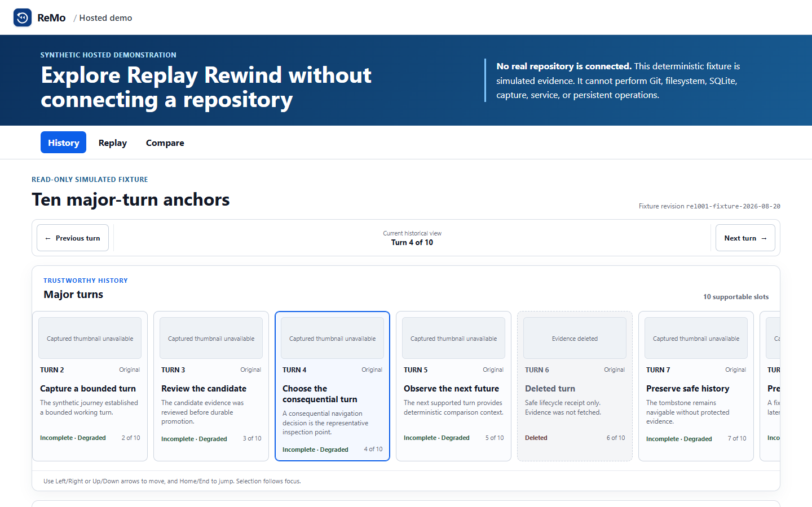

# ReMo

ReMo gives AI-assisted UI work trustworthy save points you can inspect, replay, compare, and branch from.

[**Live demo**](https://remo-demo.vercel.app) · [Architecture](docs/architecture.md) · [Privacy boundary](docs/privacy.md) · [License](LICENSE)

[](LICENSE)



## Features

- Ties source state, captured UI, decisions, and verification evidence to one save point
- Replays bounded interaction evidence without treating a screenshot as the whole story
- Keeps major turns navigable as a trustworthy history, including safe deletion tombstones
- Compares adjacent turns with qualified evidence instead of an invented equivalence verdict
- Branches from an approved historical point while preserving the original future
- Surfaces missing, mismatched, or unavailable evidence instead of fabricating success

## Try the hosted demo locally

Install Node.js 24.17 and pnpm 11.18, then run:

```bash
pnpm install --frozen-lockfile
pnpm --dir apps/web run build:demo
pnpm --dir apps/web run preview
```

Open <http://127.0.0.1:4174>. This build uses immutable synthetic evidence; it does not connect to a repository or local ReMo service.

## How it works

The complete ReMo runtime is local-first: a loopback service correlates source authority, captured browser evidence, decisions, and verification into durable save points. The hosted composition is a separate static build that demonstrates the reviewed workflow with a manifest-bound fixture and explicitly simulated branching. See the [architecture overview](docs/architecture.md).

## Privacy

- The hosted demo contains synthetic fixture data only and makes no repository, local-service, or third-party requests.
- The complete product keeps operational evidence in local SQLite and content-addressed storage.
- Missing authority or failed privacy checks block promotion rather than weakening the boundary.

Details: [privacy and trust boundary](docs/privacy.md).

## Availability

The browser demo is an evaluation surface, not the complete local application. A packaged local install is on the roadmap and is not available yet.

## License

[MIT](LICENSE)
